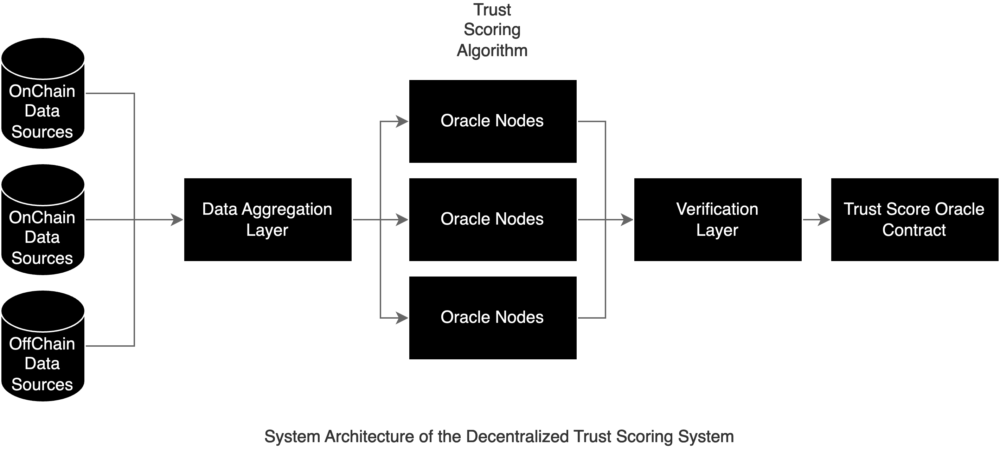

# Decentralized Trust Scoring System Using Zero-Knowledge Proofs for Blockchain Addresses

## Abstract

In this paper, we propose a decentralized trust scoring system for blockchain addresses, integrating on-chain protocol analysis with off-chain data from various AML systems, all managed by Oracle nodes. Leveraging zero-knowledge proofs (ZKPs), our approach ensures both privacy and security while meeting compliance requirements [^1]. This innovative solution addresses current centralization risks by validating trust scores transparently and fairly, discouraging dishonest behavior and promoting genuine trustworthiness.

## Introduction

Blockchain technology has been described as a "truth machine" because it provides a decentralized consensus on the timing and order of transactions, ensuring the integrity and transparency of recorded data. However, while it excels at confirming the occurrence and sequence of transactions, it does not inherently verify the broader truth of the activities or entities involved. This limitation highlights the need for additional tools and systems to enhance trust and accountability within the blockchain ecosystem.

Our proposed system functions as a decentralized truth machine for blockchain addresses, serving as an oracle that verifies the trustworthiness of entities within the blockchain ecosystem. By integrating zero-knowledge proofs (ZKP) and decentralized data aggregation through Association Set Providers (ASP), our system aims to create a reliable and transparent trust scoring mechanism.

As blockchain technology evolves, the need for a decentralized and transparent trust scoring system becomes increasingly critical. Existing centralized solutions often lack transparency and are vulnerable to monopolistic control, leading to potential misuse [^2]. A decentralized trust scoring system is necessary for two main reasons:

### Promoting Honest Behavior

An effective decentralized trust scoring system encourages participants in the ecosystem to commit to honest behavior. By providing a system where trust scores are publicly verifiable, participants have an incentive to maintain high trust scores to gain network rewards and benefits.

### Decentralized AML Data Aggregation

Currently, centralized AML data providers each maintain their own address information systems. By using a decentralized aggregation method, these providers can ensure mutual benefits while creating the largest blockchain AML system. This multi-win approach guarantees the interests of all parties involved, leading to a more robust and comprehensive AML framework.

### Problem Statement

The main issues with centralized trust scoring systems include:

- **Lack of Transparency**: Centralized systems often operate opaquely, making it difficult for users to understand how scores are calculated and whether they are fair.
- **Risk of Monopolistic Control**: A single entity controlling the trust scoring system can manipulate scores for its benefit, potentially leading to misuse and distrust within the ecosystem.
- **Limited Incentives for Honest Behavior**: A centralized system does not adequately incentivize users to commit to honest behavior, as the benefits of maintaining high trust scores are not as apparent or guaranteed.

A decentralized trust scoring system addresses these issues by providing a publicly verifiable trust score for each address. This allows participants to gain network incentives and ensures that honest behavior is rewarded. Conversely, dishonest behavior is clearly marked, allowing protocols and networks to protect their assets and users.

### Objectives

This paper aims to design a trust scoring system that:

- Integrates on-chain protocol analysis with off-chain AML data.
- Utilizes Oracle nodes to manage data and compute trust scores.
- Leverages zero-knowledge proofs to ensure privacy and validate scores.
- Provides a fair, transparent, and decentralized solution to trust scoring.
- Hypothesizes the potential for creating a significant on-chain AML framework through effective decentralized data integration.

## Technical Background

### Centralized vs. Decentralized Trust Scoring

Centralized trust scoring systems have been the norm in various industries, including finance and credit. However, in the context of blockchain, these systems present several critical issues:

- **Lack of Transparency**: Centralized systems often operate in a black-box manner. Users cannot see how their scores are calculated or why certain decisions are made. This lack of transparency can lead to mistrust and skepticism among users.
- **Risk of Monopolistic Control**: A single entity controlling the trust scoring system can manipulate scores to serve its interests. This centralization of power undermines the principles of decentralization and trustlessness that are foundational to blockchain technology.
- **Data Fragmentation**: Centralized AML data providers maintain their own address information systems, leading to fragmentation and inefficiencies. Without a unified, decentralized system, it is challenging to have a comprehensive view of address behaviors across different platforms.

In contrast, decentralized trust scoring systems offer several advantages:

- **Transparency and Accountability**: By utilizing blockchain technology, trust scores and the processes behind them can be made transparent and verifiable. This openness helps build trust among users and ensures accountability.
- **Distributed Control**: Decentralized systems distribute control among multiple nodes, reducing the risk of manipulation and ensuring that no single entity has undue influence over the trust scoring process.
- **Efficient Data Aggregation**: Decentralized aggregation of AML data allows for a more comprehensive and efficient system. By pooling data from various sources, the system can provide more accurate and reliable trust scores.

### Zero-Knowledge Proofs in Blockchain

Zero-Knowledge Proofs (ZKPs) are cryptographic techniques that allow one party to prove to another that a statement is true without revealing any additional information. In the context of blockchain and trust scoring systems, ZKPs offer several critical benefits:

- **Privacy Preservation**: ZKPs enable the validation of trust scores without revealing the underlying data. This ensures that sensitive information remains confidential while still allowing for the verification of trustworthiness.
- **Compliance**: By using ZKPs, the system can prove that trust scores are based on legitimate data and calculations, ensuring compliance with regulatory requirements without compromising user privacy [^1].
- **Integrity and Security**: ZKPs provide strong cryptographic assurances that the trust scores have not been tampered with. This enhances the integrity and security of the trust scoring system.

### Application of Zero-Knowledge Proofs in Trust Scoring

In the proposed decentralized trust scoring system, ZKPs are used to validate trust scores derived from a combination of on-chain behaviors and off-chain events. The process involves the following steps:

- **Data Collection**: Oracle nodes collect data from on-chain transactions and off-chain AML systems. This data includes interaction metrics, attestations, and labels from various AML providers.
- **Score Calculation**: The trust scoring algorithm aggregates the collected data to calculate a trust score for each address. This score reflects the address's behavior and interactions within the blockchain ecosystem.
- **Zero-Knowledge Proof Generation**: To ensure the privacy of the underlying data, ZKPs are generated to validate the trust scores. These proofs demonstrate that the scores are based on legitimate data and calculations without revealing any sensitive information.
- **Verification**: Other participants in the network can verify the trust scores using the generated ZKPs. This verification process ensures that the trust scores are accurate and trustworthy while preserving the privacy of the underlying data.

## Proposed System

### System Architecture

The proposed decentralized trust scoring system integrates on-chain protocol analysis with off-chain AML data, all managed by Oracle nodes. This architecture ensures a comprehensive approach to calculating trust scores while maintaining privacy and compliance. The system's architecture can be divided into the following components:

- **Oracle Nodes**: Oracle nodes are responsible for aggregating data from both on-chain and off-chain sources. They collect interaction metrics, AML data, and other relevant information needed to compute trust scores.
- **Data Aggregation Layer**: This layer integrates data from various sources, ensuring that the data is accurate and up-to-date. It processes information from blockchain transactions and AML systems to provide a holistic view of each address's activities.
- **Trust Scoring Algorithm**: The core component of the system, this algorithm calculates trust scores based on aggregated data. It considers factors such as transaction history, interaction with other addresses, and AML labels.
- **Zero-Knowledge Proof Generation**: This component generates zero-knowledge proofs to validate the trust scores. These proofs ensure that the scores are derived from legitimate data without revealing any sensitive information.
- **Verification Layer**: The verification layer allows other network participants to verify the trust scores using the generated zero-knowledge proofs. This ensures transparency and trustworthiness of the scores.
- **Trust Score Oracle Contract**: This is the final component that publishes the verified trust scores to the blockchain, making them accessible for other smart contracts and applications.

### Trust Scoring Algorithm

The trust scoring algorithm is designed to be both comprehensive and fair, taking into account various factors that reflect the behavior and interactions of blockchain addresses. The algorithm works as follows:

- **Data Collection**: Oracle nodes collect data from on-chain transactions, such as the frequency and volume of transactions, interactions with other addresses, and participation in smart contracts. Off-chain data, including AML labels and event-based information, is also aggregated.
- **Score Calculation**: The collected data is fed into the trust scoring algorithm, which assigns weights to different factors based on their relevance. For example, consistent participation in legitimate transactions may have a higher weight than occasional interactions.
- **Aggregation and Normalization**: The algorithm aggregates the weighted data to compute an initial trust score. This score is then normalized to ensure consistency across different addresses and data sources.
- **Zero-Knowledge Proof Generation**: Once the trust score is calculated, a zero-knowledge proof is generated to validate the score. This proof ensures that the score is based on legitimate data and calculations without revealing any sensitive information.
- **Score Adjustment**: Based on the zero-knowledge proof, the trust score may be adjusted to reflect any discrepancies or anomalies detected during the validation process.
- **Final Trust Score**: The final trust score is then published on the blockchain, where it can be verified by other network participants using the generated zero-knowledge proofs.

### Incorporating MarketTrust Model Elements

To enhance our trust scoring algorithm, we integrate key aspects of the MarketTrust model used in SIoT-based smart marketplaces. This integration focuses on familiarizing components, personal interactions, and public perception to create a robust and comprehensive trust scoring system.

- **Familiarity Modeling**: Evaluate the credibility of addresses by considering factors such as response time, resource availability, success rate, willingness to cooperate, and integrity. This aligns with the familiarity aspect of the MarketTrust model.
- **Personal Interaction Modeling**: Assess trust based on past interactions, including interaction intensity, value, and current experience. This reflects the personal interaction component of MarketTrust.
- **Public Perception Modeling**: Integrate individual interaction data to form a public perception score. This combined view of trust from the community enhances the accuracy and reliability of trust scores.
- **Security Against Attacks**: 
  - **Opportunistic Service Attacks**: By analyzing the behavior patterns and identifying anomalies, we can detect and mitigate such attacks.
  - **Bleaching Attacks**: Continuously monitor for sudden changes in behavior that do not align with historical data.
  - **Self-Promoting Attacks**: Validate interactions through cross-referencing with multiple sources to ensure authenticity.
  - **Defamation Attacks**: Use consensus mechanisms to filter out false negative reports.
  - **Voting Attacks**: Implement mechanisms to ensure that trust scores are not unduly influenced by a small group of malicious actors.
  - **Discrimination Attacks**: Ensure that the trust scoring process is fair and unbiased across different entities.
- **Incentive Mechanisms**: Develop reward and punishment systems to encourage honest behavior and deter malicious activities. For example, addresses with high trust scores can receive incentives, while those with low scores face restrictions or penalties.

## Evaluation

Evaluating the proposed decentralized trust scoring system involves analyzing its performance, security, and compliance with regulatory standards. The evaluation provides insights into the system's effectiveness and identifies areas for improvement.

### Performance Analysis

- **Metrics for Evaluation**: Key performance metrics include computation time, scalability, and resource utilization. These metrics help assess the efficiency of the trust scoring algorithm and the zero-knowledge proof mechanism.
- **Experimental Setup**: The system is deployed in a controlled environment to simulate real-world conditions. Various scenarios, such as high transaction volumes and diverse data sources, are tested to evaluate the system's performance.
- **Results and Analysis**: The experimental results are analyzed to determine the system's efficiency. Metrics such as the average computation time for trust score calculation and proof generation are measured. The system's scalability is evaluated by increasing the number of transactions and data sources.
- **Optimization Opportunities**: Based on the performance analysis, potential optimizations are identified. These include improvements in the trust scoring algorithm, enhancements in the zero-knowledge proof generation process, and better resource management.

### Security Analysis

- **Assessment of Security Features**: The security features of the system are evaluated to ensure the integrity and reliability of trust scores. This includes analyzing the robustness of the zero-knowledge proof mechanism and the protection of sensitive data.
- **Potential Vulnerabilities**: The system is examined for potential vulnerabilities that could be exploited by malicious actors. This includes evaluating the risk of data tampering, unauthorized access, and other security threats.
- **Mitigation Strategies**: Strategies to mitigate identified vulnerabilities are developed. This includes implementing additional security measures, such as enhanced encryption techniques and multi-factor authentication for Oracle nodes.
- **Attack Simulations**: The system undergoes various attack simulations to test its resilience against potential security threats. This helps identify weaknesses and areas for improvement in the system's security architecture.

### Compliance and Decentralization Evaluation

- **Regulatory Compliance**: The system's compliance with regulatory standards is evaluated. This includes ensuring that the trust scoring process adheres to AML regulations and other relevant legal requirements.
- **Decentralization Aspects**: The degree of decentralization achieved by the system is analyzed. This includes assessing the distribution of control among Oracle nodes and ensuring that no single entity has undue influence over the trust scoring process.
- **Transparency and Fairness**: The system's transparency and fairness are evaluated by examining the trust score calculation process and the verification of zero-knowledge proofs. This ensures that the system operates in an open and equitable manner.
- **Stakeholder Feedback**: Feedback from various stakeholders, including users, AML data providers, and regulatory authorities, is collected and analyzed. This helps ensure that the system meets the needs and expectations of all parties involved.

By conducting a comprehensive evaluation, the proposed decentralized trust scoring system can be assessed for its performance, security, and compliance. This ensures that the system is robust, efficient, and capable of providing accurate and trustworthy trust scores.

## Discussion

### Advantages of the Proposed System

The proposed decentralized trust scoring system offers several key advantages over existing solutions:

- **Enhanced Transparency**: By utilizing blockchain technology and zero-knowledge proofs, the system ensures that trust scores are transparent and verifiable. This transparency builds trust among users and stakeholders.
- **Improved Privacy**: The integration of zero-knowledge proofs ensures that the underlying data used to calculate trust scores remains private. This protects user privacy while still allowing for the verification of trustworthiness.
- **Decentralized Control**: The system distributes control among multiple Oracle nodes, reducing the risk of manipulation and ensuring that no single entity has undue influence over the trust scoring process. This decentralized approach aligns with the core principles of blockchain technology.
- **Scalability**: The system is designed to handle a large volume of transactions and data sources. By efficiently aggregating and processing data, the system can scale to meet the needs of a growing blockchain ecosystem.
- **Compliance with Regulatory Standards**: By integrating AML data and adhering to regulatory requirements, the system ensures that trust scores are compliant with global standards. This makes the system suitable for use in regulated industries and enhances its credibility.
- **Incentivizing Honest Behavior**: The system rewards honest behavior by providing higher trust scores to addresses that engage in legitimate activities. This incentivizes participants to maintain good practices and contributes to the overall health of the blockchain ecosystem.

### Challenges and Limitations

Despite its advantages, the proposed system also faces several challenges and limitations:

- **Complexity of Implementation**: Integrating zero-knowledge proofs and managing Oracle nodes requires significant technical expertise. Ensuring that the system is robust and secure adds to the complexity of implementation.
- **Data Aggregation Challenges**: Aggregating data from diverse on-chain and off-chain sources can be challenging. Ensuring data accuracy and consistency is critical to the system's success.
- **Performance Overheads**: The processes of generating and verifying zero-knowledge proofs can introduce performance overheads. Optimizing these processes to minimize delays and resource consumption is essential.
- **Regulatory Uncertainty**: The regulatory landscape for blockchain and AML compliance is constantly evolving. Ensuring that the system remains compliant with changing regulations requires ongoing monitoring and adjustments.
- **Adoption and Integration**: Encouraging widespread adoption of the system and integrating it with existing blockchain networks and AML providers can be challenging. Building partnerships and demonstrating the system's value are key to overcoming this hurdle.
- **Resistance to Change**: Established entities with existing centralized systems may resist adopting a decentralized approach. Overcoming this resistance requires demonstrating the clear benefits of the proposed system.

By addressing these challenges and limitations, the proposed system can be further refined and improved to better serve the needs of the blockchain ecosystem. Continuous development and collaboration with stakeholders are essential to realizing the full potential of the decentralized trust scoring system.

## Conclusion

In this paper, we have proposed a decentralized trust scoring system for blockchain addresses, integrating on-chain protocol analysis with off-chain data from various AML systems, managed by Oracle nodes. By leveraging zero-knowledge proofs, our approach ensures both privacy and security while providing accurate and verifiable trust scores.

The key contributions of this paper include:

- **Innovative System Architecture**: We introduced a comprehensive system architecture that integrates decentralized data aggregation and zero-knowledge proofs to create a robust trust scoring mechanism.
- **Enhanced Privacy and Compliance**: Our system preserves user privacy and complies with regulatory standards by using zero-knowledge proofs to validate trust scores without revealing sensitive information.
- **Decentralized Control and Transparency**: By distributing control among Oracle nodes and ensuring transparency in the trust scoring process, our system aligns with the core principles of blockchain technology.
- **Incentivizing Honest Behavior**: The system rewards honest behavior and helps protect the blockchain ecosystem by clearly marking dishonest addresses.

Despite its advantages, the proposed system faces several challenges, including the complexity of implementation, data aggregation difficulties, and performance overheads. Addressing these challenges requires continuous development and collaboration with stakeholders.

## Future Work

Future research and development efforts should focus on the following areas:

- **Optimization of Zero-Knowledge Proofs**: Further work is needed to optimize the generation and verification processes for zero-knowledge proofs to reduce performance overheads.
- **Enhanced Data Aggregation Techniques**: Developing more efficient methods for aggregating and normalizing data from diverse sources will improve the accuracy and reliability of trust scores.
- **Regulatory Adaptation**: Monitoring and adapting to the evolving regulatory landscape will ensure ongoing compliance and relevance of the trust scoring system.
- **Wider Adoption and Integration**: Building partnerships and demonstrating the system's value will encourage wider adoption and integration with existing blockchain networks and AML providers.
- **User Education and Engagement**: Educating users about the benefits of decentralized trust scoring and engaging them in the process will help drive adoption and improve the overall effectiveness of the system.

By addressing these areas, the proposed decentralized trust scoring system can be further refined and enhanced, providing a powerful tool for maintaining trust and security in the blockchain ecosystem. The continuous evolution of this system will contribute to a more transparent, secure, and trustworthy blockchain environment.

## References

[^1]: Vitalik Buterin, Jacob Illum, Matthias Nadler, Fabian Schär, Ameen Soleimani. "Blockchain Privacy and Regulatory Compliance: Towards a Practical Equilibrium", 2023. Available: [https://papers.ssrn.com/sol3/papers.cfm?abstract_id=4563364](https://papers.ssrn.com/sol3/papers.cfm?abstract_id=4563364)

[^2]:
